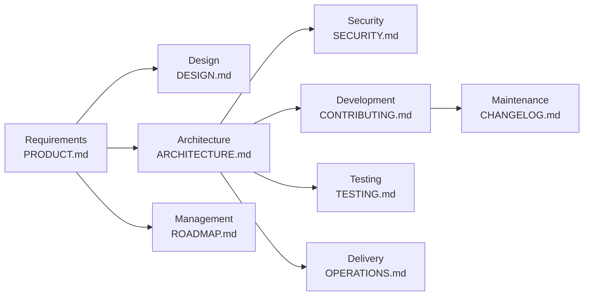

<div align="center">


# Software Engineering Skills

**Agent Skills that guide a software project through its whole lifecycle, from the first requirement to the last release.**

[](https://github.com/hernancham2/software-engineering-skills/stargazers)
[](LICENSE)
[](https://github.com/hernancham2/software-engineering-skills/commits/main)
[](https://agentskills.io/specification)

**English** · [Español](docs/es/README.md) · [Documentation](docs/en/README.md) · [Skill catalog](docs/en/README.md#catalog)

</div>

---

AI agents answer better when they know what was already decided. These skills make every decision of a project land in one fixed file (`PRODUCT.md`, `DESIGN.md`, `ARCHITECTURE.md`…), so the next phase reads it instead of asking again.

- **The whole lifecycle.** Requirements, design, architecture, development, testing, security, delivery, maintenance and management, each with the same three roles: discover, define and validate.
- **A shared project context.** Skills read and write a small set of files that any person or agent can open. No hidden state.
- **Portable.** They follow the open [Agent Skills](https://agentskills.io/specification) format, so they work in Claude Code, Codex / ChatGPT, Gemini CLI, Antigravity, opencode, Cursor, GitHub Copilot and any compatible agent.
- **Install only what you use.** One plugin per phase in Claude Code, or a single skill with the `skills` CLI.
- **They answer in your language.** The skills are written in English and reply in the language of whoever asks.

## Quick start

```bash
npx skills add hernancham2/software-engineering-skills
```

Then ask your agent, in your own words, to start a project:

> I want to build an app to manage appointments for a clinic. Where do I start?

The agent activates `pm-context`, sets up `AGENTS.md`, tells you which files are missing and which skill comes next. You do not need to name any skill.

More ways to install:

| You use | Command |
| --- | --- |
| Claude Code (one plugin per phase) | `claude plugin marketplace add hernancham2/software-engineering-skills` |
| One skill only | `npx skills add hernancham2/software-engineering-skills --skill req-elicit` |
| A specific agent | `npx skills add hernancham2/software-engineering-skills -a codex` |
| Gemini CLI | `gemini skills install https://github.com/hernancham2/software-engineering-skills.git --path skills/requirements/req-elicit` |

Options, plugin names and every platform are in [Publishing and installation](docs/en/publishing.md).

## How it works



Each phase gathers information in `docs/<phase>/`, turns it into decisions in its own file and validates them. Every file has a single owner phase, holds decisions only, and is linked from `AGENTS.md`. The full model is in [Project context](docs/en/context.md).

## Phases and skills

<!-- PHASES:START -->

**30 skills** in **9 phases**.

| Phase | Decides | Skills |
| --- | --- | --- |
| Requirements | `PRODUCT.md` | [`req-elicit`](skills/requirements/req-elicit/SKILL.md) · [`req-specify`](skills/requirements/req-specify/SKILL.md) · [`req-validate`](skills/requirements/req-validate/SKILL.md) |
| Visual design and brand | `DESIGN.md` | [`des-discover`](skills/design/des-discover/SKILL.md) · [`des-guidelines`](skills/design/des-guidelines/SKILL.md) · [`des-navigation`](skills/design/des-navigation/SKILL.md) · [`des-validate`](skills/design/des-validate/SKILL.md) |
| Architecture and technical design | `ARCHITECTURE.md` | [`arch-define`](skills/architecture/arch-define/SKILL.md) · [`arch-discover`](skills/architecture/arch-discover/SKILL.md) · [`arch-validate`](skills/architecture/arch-validate/SKILL.md) |
| Development | `CONTRIBUTING.md` | [`dev-conventions`](skills/development/dev-conventions/SKILL.md) · [`dev-implement`](skills/development/dev-implement/SKILL.md) · [`dev-review`](skills/development/dev-review/SKILL.md) |
| Testing and quality | `TESTING.md` | [`qa-cases`](skills/testing/qa-cases/SKILL.md) · [`qa-strategy`](skills/testing/qa-strategy/SKILL.md) · [`qa-validate`](skills/testing/qa-validate/SKILL.md) |
| Security | `SECURITY.md` | [`sec-define`](skills/security/sec-define/SKILL.md) · [`sec-review`](skills/security/sec-review/SKILL.md) · [`sec-threats`](skills/security/sec-threats/SKILL.md) |
| Delivery and operations | `OPERATIONS.md` | [`ops-define`](skills/delivery/ops-define/SKILL.md) · [`ops-discover`](skills/delivery/ops-discover/SKILL.md) · [`ops-incident`](skills/delivery/ops-incident/SKILL.md) · [`ops-validate`](skills/delivery/ops-validate/SKILL.md) |
| Maintenance and evolution | `CHANGELOG.md` | [`mnt-changelog`](skills/maintenance/mnt-changelog/SKILL.md) · [`mnt-debt`](skills/maintenance/mnt-debt/SKILL.md) · [`mnt-migrate`](skills/maintenance/mnt-migrate/SKILL.md) |
| Project management | `ROADMAP.md` | [`pm-context`](skills/management/pm-context/SKILL.md) · [`pm-plan`](skills/management/pm-plan/SKILL.md) · [`pm-risks`](skills/management/pm-risks/SKILL.md) · [`pm-status`](skills/management/pm-status/SKILL.md) |

<!-- PHASES:END -->

Each skill states in its metadata which files it reads and writes. The complete catalog, with descriptions, is in the [documentation](docs/en/README.md#catalog).

## Documentation

| | English | Español |
| --- | --- | --- |
| Index and skill catalog | [docs/en/README.md](docs/en/README.md) | [docs/es/README.md](docs/es/README.md) |
| How skills are written (standard) | [standard.md](docs/en/standard.md) | [standard.md](docs/es/standard.md) |
| The project context model | [context.md](docs/en/context.md) | [context.md](docs/es/context.md) |
| Publishing and installation | [publishing.md](docs/en/publishing.md) | [publishing.md](docs/es/publishing.md) |

## Contributing

Contributions are welcome: a new skill, a correction from real use, or a better description. Read the [standard](docs/en/standard.md) first, then:

```bash
npm run new -- req elicit
```

```bash
npm run check
```

`npm run check` validates every skill and fails if the generated files are out of date. Run it before every commit and every pull request. The best contribution is a **gotcha**: something an agent got wrong while using a skill, with the correction.

## License

[MIT](LICENSE) © Hernan
