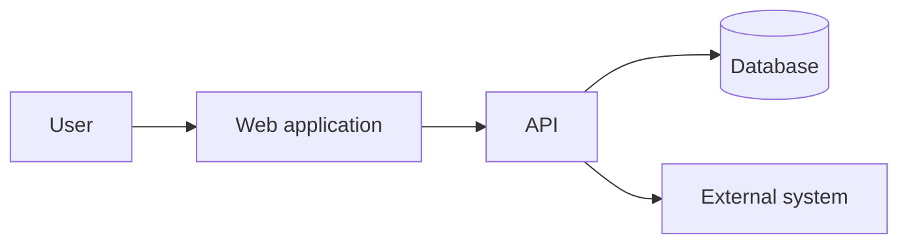
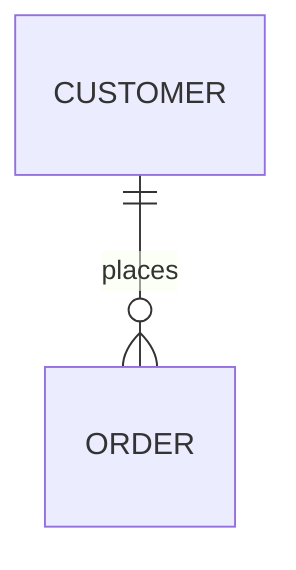

# Architecture: [project name]

Version [0.1] · [date]

Describes the system as it is today. What does not exist yet is marked as *planned*. The reason for each decision is in the ADRs.

## Overview

[Two or three sentences: what type of system it is and what its style is.]

## Stack

| Layer | Technology and version | Decision |
| :--- | :--- | :--- |
| | | [ADR-0001](docs/architecture/adr/0001-title.md) |

## Components

| Component | Responsibility | Depends on | Path |
| :--- | :--- | :--- | :--- |
| | | | |

Dependency rules:

-

## Data model

- Real schema: [path to migrations or schema file]
- Owner of each piece of data:

## Integrations

| System | Direction | Protocol | Contract | If it fails or is slow |
| :--- | :--- | :--- | :--- | :--- |
| | | | | |

## Cross-cutting concerns

- Authentication and authorization:
- Error handling:
- Logging and tracing:
- Configuration:

## How the quality requirements are met

| Requirement | Mechanism | How it is verified |
| :--- | :--- | :--- |
| NFR-01 | | |

## Decisions

| ADR | Decision | Status |
| :--- | :--- | :--- |
| [0001](docs/architecture/adr/0001-title.md) | | |

## Risks and accepted debt

| Risk or debt | Consequence | Accepted by | Revisit when |
| :--- | :--- | :--- | :--- |
| | | | |

## Source

- Drivers: [docs/architecture/drivers.md](docs/architecture/drivers.md)
- Who approves changes to this file:
