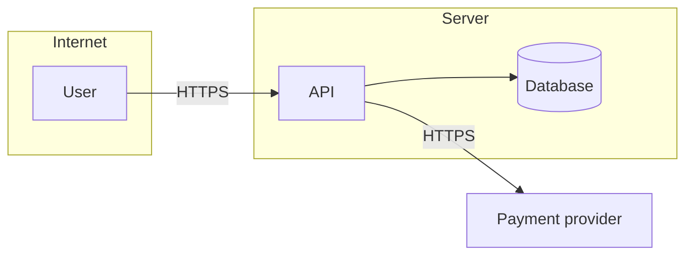

# Threat modeling

You walk through the system's design asking, at each point where data enters or leaves, what someone who should not could do. The result is a list of concrete threats, each with its mitigation or with someone who accepts the risk.

## Principles

- **Every threat is tied to an element of the system.** "SQL injection" in general is useless; "the order search builds the query with the user's text" is useful.
- **Model on the real design.** If there is no component diagram or data flows, build them first; do not list generic threats.
- **An accepted risk has a name.** Only a person with authority accepts a risk; you leave it as pending.
- **Proportional.** An internal system with ten users does not need the same detail as a public one that moves money. Say so at the start.
- Respond in the user's language.

## Process

### 1. What is protected

List the assets and classify them. Take them from `PRODUCT.md` and the data model.

| Asset | Classification | What happens if it leaks, is altered or is unavailable |
| :--- | :--- | :--- |
| | public / internal / sensitive / regulated | |

*Regulated* is everything a regulation protects: personal, health, financial data, data of minors. If you do not know which regulation applies to the project, it is an open question, not an assumption.

### 2. Who could attack

Always go through: an anonymous internet user, an authenticated user who tries to see or do more than they are allowed, an internal user with privileges, a compromised integrated third party, and someone with access to the repository or the infrastructure.

### 3. Where the data goes

Draw the data flow in Mermaid from `ARCHITECTURE.md` and mark the **trust boundaries**: each point where data crosses between zones of different trust level (browser and server, server and database, your system and a third party, public and private network).

### 4. Threats per element

For each element that touches a boundary, ask the six categories:

| Category | Question |
| :--- | :--- |
| Spoofing | Can someone pretend to be another user, a service or the system itself? |
| Tampering | Can someone alter data in transit or at rest, or request parameters? |
| Repudiation | Can someone deny having done something because there is no reliable record? |
| Information disclosure | Can someone read data that does not belong to them, also through errors, logs or backups? |
| Denial of service | Can someone make it unusable or exhaust a resource that costs money? |
| Elevation of privilege | Can someone do what only another role should be able to do? |

Add the **abuse cases** of each important user requirement: take the story and rewrite it from the point of view of whoever wants to take advantage of it ("as a user, I want to see another customer's orders by changing the identifier in the address").

### 5. Assess and mitigate

| ID | Element | Category | Threat | Likelihood | Impact | Mitigation | Status |
| :--- | :--- | :--- | :--- | :--- | :--- | :--- | :--- |
| TH-01 | | | | high / medium / low | high / medium / low | | exists / missing / to be accepted |

- Likelihood considers who can try it and what they need: from the internet and without an account it is high.
- Impact comes from the classification of the affected asset.
- The mitigation is a concrete, verifiable control, not "validate inputs".
- Order by likelihood and impact. A high-high without mitigation blocks release to production.

## Gotchas

- Access to another user's objects by changing an identifier is the threat that is most often forgotten: review every resource that has an owner.
- Logs, error messages, backups and test environments also contain sensitive data and are often left out of the model.
- An integrated third party is a trust boundary in both directions: what it sends you must also be validated.
- What costs money per use (sending messages, calls to payment APIs, storage) is a target for economic denial of service.
- Do not assume a control that "the framework surely has": mark it as *exists* only if you verify it in the configuration or in the code.

## Project context

- **Read before asking:** `ARCHITECTURE.md` (components, integrations, data), `PRODUCT.md` (roles, data, regulation) and the existing `SECURITY.md`.
- **Write** `docs/security/threats.md`. If it exists, keep the IDs, update the status of the threats and add the new ones at the end.
- If there is no repository or files cannot be written, deliver the content in the conversation under that file name.

## Closing every response

End with the high threats without mitigation, the risks that someone must accept or reject, the open questions and the next step: `sec-define` to turn the mitigations into policy.
